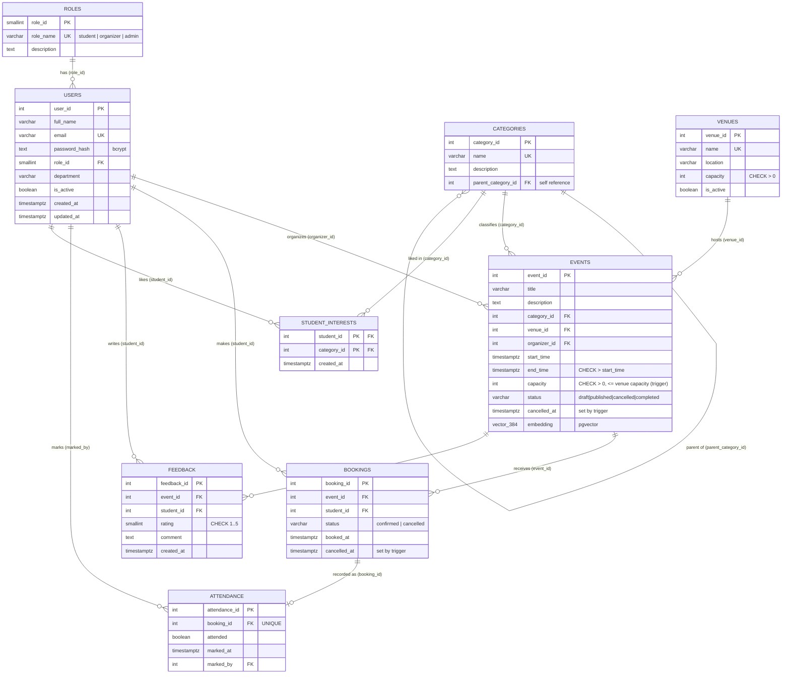

# ER Diagram

This diagram is generated from the **implemented** schema (`db/schema/001_schema.sql` + `003_vector.sql`), not from an imaginary design.
It renders on GitHub, in VS Code (Markdown Preview Mermaid Support) and at <https://mermaid.live>.

## Cardinalities in words

| Relationship | Cardinality | Implemented by |
|---|---|---|
| Role - User | one role has many users; a user has exactly one role | `users.role_id` NOT NULL FK |
| User (organizer) - Event | one organizer organises many events; an event has exactly one organizer | `events.organizer_id` FK |
| Category - Category | a category has 0..1 parent and many children (hierarchy) | `categories.parent_category_id` self-FK |
| Category - Event | one category classifies many events | `events.category_id` FK |
| Venue - Event | one venue hosts many events (never overlapping in time) | `events.venue_id` FK + EXCLUDE constraint |
| User (student) - Booking | a student makes many bookings | `bookings.student_id` FK |
| Event - Booking | an event has many bookings (at most `capacity` confirmed) | `bookings.event_id` FK + trigger |
| Booking - Attendance | 0..1 attendance record per booking | `attendance.booking_id` UNIQUE FK |
| Student - Event via Feedback | a student rates an event at most once | `UNIQUE (event_id, student_id)` |
| Student - Category via Interests | many-to-many | junction table `student_interests` (composite PK) |

## Entity-relationship notes
* **Booking** is the associative entity of the many-to-many relationship *student attends event*; it carries its own attributes (status, timestamps).
* **Feedback** is a second associative entity between student and event.
* **student_interests** is a pure junction table resolving the many-to-many between students and categories.
* `v_event_overview`, `v_booking_details` and `v_category_paths` are views, so they are not entities in the diagram.
